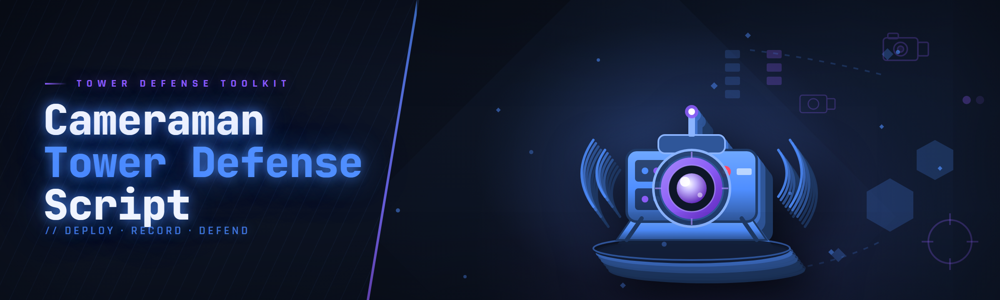

  
  
  

  

  
  

---

---

## 🗼 What Changed in the 2026 Build?

This is the changelog-style drop for the current Cameraman Tower Defense Script build — the one the subreddit has been asking about since the January patch. Here's what actually landed:

- **Full tower stat injection** — reworked the memory layer after the anti-cheat refresh so per-tower damage, range, and fire-rate writes survive a full wave now instead of reverting mid-round.
- **Cameraman targeting override** — you can now pin the cameraman's focus to specific enemy classes instead of the default nearest-first logic.
- **Economy multiplier split** — cash-per-kill and wave-bonus are now separate sliders. No more lumped "money hack" that either did nothing or maxed instantly.
- **Auto-place + auto-upgrade pipeline** — new queue system that holds placements until you have the cash, then fires them in order.
- **ESP redraw** — enemy path preview and health bars redrawn on a lighter hook, so it doesn't stutter when 40+ units spawn.
- **Config profiles** — save/load named loadouts so you don't rebuild your script setup every launch.

Full feature dump below. The .exe is the same distribution flow as always: page → download → extract → run.

---

## 🧭 Table of Contents

- [What Is the Cameraman Tower Defense Script?](#-what-is-the-cameraman-tower-defense-script)
- [Key Features](#-key-features)
- [The Problem](#-the-problem)
- [The Solution](#-the-solution)
- 

  

(#-download)
- [Is It Safe? Detection & Bypass Status](#-is-it-safe-detection--bypass-status)
- [Tower Module Catalog](#-tower-module-catalog)
- [Cameraman Control Modules](#-cameraman-control-modules)
- [Economy & Wave Modules](#-economy--wave-modules)
- [Visual / ESP Modules](#-visual--esp-modules)
- [Automation Modules](#-automation-modules)
- [AI-Assisted Setup (2026)](#-ai-assisted-setup-2026)
- [Overview](#-overview)
- [Usage Guidelines](#-usage-guidelines)
- [How It Works](#-how-it-works)
- [Hotkeys & Controls](#-hotkeys--controls)
- [Does It Work on Steam?](#-does-it-work-on-steam)
- [Community & Support](#-community--support)
- [Changelog / Release History](#-changelog--release-history)
- [Compatibility](#-compatibility)
- [Roadmap](#-roadmap)
- [FAQ](#-faq)

---

## 🎮 What Is the Cameraman Tower Defense Script?

A glossary of the terms that get thrown around in every thread, so nobody has to ask "what does X mean" again.

| Term | Explanation |
|------|-------------|
| **Cameraman** | The core defender unit in Cameraman Tower Defense — places, upgrades, and fires; the script hooks its targeting and stat values. |
| **Tower stat injection** | Writing damage / range / fire-rate values directly into the tower's runtime memory so upgrades apply instantly. |
| **Targeting override** | Forcing the cameraman (or any tower) to prioritize a chosen enemy class instead of nearest-first. |
| **ESP** | Overlay that draws enemy health bars, path previews, and spawn markers on top of the game. |
| **Auto-place queue** | A scripted placement list that waits for sufficient cash, then drops towers in order. |
| **Wave multiplier** | Scaling factor applied to cash earned per kill or per wave bonus. |
| **Bypass layer** | The part of the script that keeps memory writes from tripping the game's integrity checks. |

Why people run it:

- Grinding late waves manually is slow — the script automates placement and upgrades so runs don't stall.
- Testing tower combos is way faster when you can pin stats and reset instantly.
- The ESP makes wave composition readable before it hits your lane.
- Config profiles mean a fresh session starts at your usual setup, not from scratch.
- It's a single .exe — no runtime installs, no dependency hell.

---

## ⚔️ Key Features

| Feature | Description | Benefit |
|---------|-------------|---------|
| Tower stat injection | Live writes to damage, range, fire-rate per tower | Skip the upgrade grind |
| Cameraman targeting pin | Lock focus to a chosen enemy class | Stop leaks on fast units |
| Cash multiplier (split) | Separate kill-cash and wave-bonus sliders | Tune economy without breaking the run |
| Auto-place queue | Ordered placement that waits for cash | Hands-off early waves |
| Auto-upgrade ladder | Priority-based upgrade path | No more manual clicking |
| Enemy path preview | Draws the exact path to your base | Plan tower spots properly |
| Health bar ESP | Overlay bars on every enemy | Read threats at a glance |
| Wave inspector | Shows next wave composition | Pre-place counters |
| Config profiles | Named save/load of all settings | Instant session setup |
| Hotkey rebinding | Remap every action | Fits your layout |
| Safe-mode limiter | Caps write frequency | Lower detection surface |
| Panic unload | One key reverts all writes | Clean exit if something looks off |

---

## 🧩 The Problem

If you've played Cameraman Tower Defense for more than a weekend, you've hit most of these:

- Late waves turn into a click-fest — you're upgrading towers one by one while enemies stream past.
- Cash pacing is brutal early; you can't test a build because you can't afford it.
- The cameraman's default targeting dumps shots into tanky units while fast ones slip through.
- You can't see enemy health, so you over-build "just in case" and waste cash.
- Wave composition is a mystery until it's already spawning.
- Every session starts from zero — no saved loadout, no saved settings.
- Half the "scripts" floating around are dead after the last patch and nobody says so.

---

## 🛠️ The Solution

Row-for-row mirror of the pain points above:

| Problem | Solution |
|---------|----------|
| Late-wave click-fest | Auto-upgrade ladder applies priority upgrades for you |
| Cash pacing blocks testing | Split cash multipliers — tune kill-cash and wave-bonus independently |
| Cameraman mistargets | Targeting override pins focus to a chosen enemy class |
| Can't see enemy health | Health bar ESP overlays every unit |
| Wave composition is hidden | Wave inspector previews the next spawn set |
| No saved loadout | Config profiles save and restore everything |
| Dead scripts after patches | Bypass layer maintained against the current build (see status table) |

---

## 📥 Download

Grab the current 2026 build from the project page. No installers, no dependencies — just extract and run.

  

---

## 🛰️ Is It Safe? Detection & Bypass Status

The honest table. This is what the bypass layer is currently doing against the live build — updated each patch cycle.

| Method | Status | Notes |
|--------|--------|-------|
| Tower stat write hook | ✅ Working | Rewritten for the Jan 2026 anti-cheat refresh |
| Cameraman targeting override | ✅ Working | Uses a lighter call-site hook, no direct patch |
| Cash multiplier | ✅ Working | Rate-limited to stay under write-frequency checks |
| ESP overlay | ✅ Working | External overlay, no in-process draw calls |
| Auto-place queue | ✅ Working | Input-simulation based, not memory writes |
| Wave inspector read | ✅ Working | Read-only memory scan, no writes |
| Config profile save/load | ✅ Working | File-based, nothing touches game memory |
| Integrity check bypass | ⚠️ Partial | Works on offline/solo; online modes untested |
| Cloud-save sync | ❌ Not supported | Dashboard sync flags modified saves — keep cloud off |

> Use at your own risk. This is a hobbyist/educational reverse-engineering project — respect the game's terms and don't take it into competitive or online modes.

---

## 🏰 Tower Module Catalog

**Tower Stats**

| Feature | Effect |
|---------|--------|
| Damage injection | Per-tower damage value override |
| Range injection | Extends or trims tower range live |
| Fire-rate injection | Adjusts shots-per-second per tower |
| Upgrade skip | Applies next-tier stats without paying |
| Stat snapshot | Saves current tower stats to a profile slot |

**Placement**

| Feature | Effect |
|---------|--------|
| Ghost placement | Shows valid/invalid spots before confirming |
| Grid snap | Aligns placement to the tile grid |
| Duplicate last | Re-places the same tower type instantly |
| Bulk place | Drops a template pattern in one action |

---

## 🎥 Cameraman Control Modules

**Targeting**

| Feature | Effect |
|---------|--------|
| Class pin | Forces focus onto a chosen enemy class |
| Priority list | Ordered target priority (e.g. fast → tanky) |
| Manual override | Click-to-focus a single enemy |
| Leak guard | Re-targets enemies about to reach the base |

**Cameraman QoL**

| Feature | Effect |
|---------|--------|
| Auto-reposition | Moves cameraman to the highest-threat lane |
| Cooldown reset | Clears ability cooldowns for testing |
| Range ring | Draws the cameraman's effective range |
| Focus indicator | Shows current target with a marker |

---

## 💰 Economy & Wave Modules

**Cash**

| Feature | Effect |
|---------|--------|
| Kill-cash multiplier | Scales cash earned per kill |
| Wave-bonus multiplier | Scales the end-of-wave payout |
| Instant test-funds | One-shot cash injection for build testing |
| Rate limiter | Caps how fast cash changes, for safer writes |

**Waves**

| Feature | Effect |
|---------|--------|
| Wave preview | Shows next wave's composition |
| Spawn marker ESP | Highlights spawn points and timers |
| Skip-wave (solo) | Advances to the next wave on demand |
| Pause-on-threat | Auto-pauses when a leak is imminent |

---

## 👁️ Visual / ESP Modules

**Overlays**

| Feature | Effect |
|---------|--------|
| Health bars | Bar over every enemy |
| Path preview | Traces the exact route to base |
| Tower range rings | Shows each tower's coverage |
| Threat heatmap | Highlights dense enemy clusters |

**UI**

| Feature | Effect |
|---------|--------|
| Overlay opacity | Adjusts ESP transparency |
| Color themes | Preset palettes for readability |
| Toggle groups | Hide/show module categories with one key |
| FPS counter | Lightweight overlay FPS readout |

---

## 🤖 Automation Modules

**Placing & Upgrading**

| Feature | Effect |
|---------|--------|
| Auto-place queue | Ordered placement that waits for cash |
| Auto-upgrade ladder | Priority-based upgrade path |
| Cash threshold gate | Only upgrades when cash exceeds a set value |
| Pattern presets | Saved placement templates |

**Session**

| Feature | Effect |
|---------|--------|
| Auto-start run | Begins a run from the menu |
| Auto-restart | Restarts on loss (solo) |
| AFK mode | Runs the queue without input |
| Panic unload | Reverts all writes on one key |

---

## 🧠 AI-Assisted Setup (2026)

The 2026 build adds an optional LLM-powered helper. It's not magic — it reads your current wave, tower layout, and cash, and suggests a build plan in plain language.

- **Build advisor** — paste your wave number and cash; get a suggested tower/upgrade order.
- **Pattern explainer** — describes why a placement template works, in text.
- **Config translator** — converts a written strategy ("rush damage, ignore range") into slider values.
- **Patch notes summarizer** — pulls the latest patch notes into a short "what changed for the script" digest.
- **Error decoder** — if the script throws a hook error, it explains what tripped in plain English.

The AI features are entirely optional and run against a configurable endpoint — nothing is sent anywhere unless you turn it on. If you don't care about it, ignore the tab; the core script works exactly the same.

---

## 📊 Overview

| Category | Details |
|----------|---------|
| **What it is** | A tower-defense script/toolkit for Cameraman Tower Defense — stat injection, ESP, automation, and config profiles. |
| **Distribution** | Single .exe, extracted from a zip; no installer, no runtime dependencies. |
| **Platform** | Windows 10 / 11 (64-bit). |
| **Build** | 2026.2, maintained against the current game patch. |
| **Config** | Named profiles saved locally as plain files. |
| **Bypass** | External overlay + rate-limited writes; kept current each patch cycle. |
| **Support** | Community forum thread + subreddit; issues tracked in this repo. |

The short version: this is the toolkit I wished existed when I started grinding late waves. It's built by someone who spent way too long reading forum threads and patching their own scripts after every game update — so it's organized around the actual pain points, not a feature list written by someone who never played.

---

## ✅ Usage Guidelines

| Allowed | Not allowed |
|---------|-------------|
| Solo / offline play | Online or competitive modes |
| Testing builds and tower combos | Selling or redistributing the build |
| Learning how memory hooks work | Using it to grief other players |
| Personal config profiles | Bypassing paid content you don't own |
| Reporting bugs and patch breakage | Claiming it's your own work |

---

## ⚙️ How It Works

Under the hood, the script runs as a separate process that attaches to the game and hooks a small set of call sites — primarily the tower update loop, the targeting selector, and the cash payout function. Rather than patching the game's own code in place (which is what gets flagged instantly), it uses an external overlay for the ESP and rate-limited writes for stats, so the game's integrity checks see normal-looking values most of the time. The auto-place queue is deliberately dumb: it simulates input rather than writing to memory, which is slower but far less likely to trip anything. Config profiles are plain local files, so nothing about your setup leaves your machine. The bypass layer is the part that gets rewritten every patch — the rest of the modules are stable across updates because they sit on top of that layer rather than poking the game directly.

---

## ⌨️ Hotkeys & Controls

| Key | Action | Notes |
|-----|--------|-------|
| `F1` | Toggle overlay | Shows/hides all ESP |
| `F2` | Open module panel | Main config UI |
| `F3` | Toggle auto-place queue | Starts/stops the queue |
| `F4` | Toggle auto-upgrade | Applies the upgrade ladder |
| `F5` | Cycle config profile | Loads next saved profile |
| `F6` | Wave inspector | Shows next wave composition |
| `F7` | Panic unload | Reverts all writes instantly |
| `F8` | Safe-mode toggle | Caps write frequency |
| `F9` | Reload script | Re-attaches after a game restart |
| `F10` | Screenshot config | Saves current settings snapshot |

All keys are rebindable in the panel — these are just the defaults.

---

## 🎮 Does It Work on Steam?

Yes — the script targets the Steam build of Cameraman Tower Defense, including the current 2026 patch. A few notes:

- **Works on:** Steam solo/offline runs.
- **Untested on:** Online multiplayer and any cloud-synced saves — keep Steam Cloud off while the script is attached, or the sync can flag modified saves.
- **After a game update:** wait for a script patch — the bypass layer almost always needs a refresh after a major game update. Check the changelog before assuming it's broken.
- **Admin rights:** run the .exe as administrator if the overlay doesn't attach — the game's process protection sometimes needs it.

---

## 💬 Community & Support

- **Issues** — open one in this repo with your build number and a short description of what broke.
- **Forum thread** — the long-running Cameraman Tower Defense Script thread is where patch-breakage reports get triaged first.
- **Subreddit** — search the sub for "script" before posting; most questions are already answered.
- **Config sharing** — drop your profile files in the community thread if you've got a build worth sharing.
- **Patch notes** — I post a short digest after every game update explaining what changed for the script.

If you're reporting a bug, include: game version, script build, which module broke, and whether safe-mode was on. That cuts triage time in half.

---

## 📜 Changelog / Release History

| Version | Date | Changes |
|---------|------|---------|
| 2026.2 | Q1 2026 | Targeting override rework; split cash multipliers; auto-place queue; config profiles; ESP redraw on lighter hook |
| 2026.1 | Q1 2026 | Post-Jan-patch bypass refresh; wave inspector added; panic unload |
| 2025.4 | Q4 2025 | Auto-upgrade ladder; safe-mode limiter; hotkey rebinding |
| 2025.3 | Q3 2025 | Health bar ESP; path preview; rate-limited writes |
| 2025.2 | Q2 2025 | Initial tower stat injection; basic overlay |

---

## 🖥️ Compatibility

| Component | Minimum | Recommended |
|-----------|---------|-------------|
| OS | Windows 10 (64-bit) | Windows 11 (64-bit) |
| RAM | 8 GB | 16 GB |
| GPU | Any DX11-capable | Any DX12-capable |
| Game build | Current Steam build | Current Steam build |
| Admin rights | Optional | Recommended (overlay attach) |
| Steam Cloud | Off | Off |

---

## 🗺️ Roadmap

| Feature | Status | ETA |
|---------|--------|-----|
| Online-mode bypass research | 🔬 Researching | TBD |
| Build advisor v2 (better suggestions) | 🛠️ In progress | Q2 2026 |
| Pattern-sharing export format | 📋 Planned | Q2 2026 |
| Mac/Linux via Proton testing | 📋 Planned | Q3 2026 |
| Auto-restart reliability pass | 🛠️ In progress | Q2 2026 |
| Config cloud sync (opt-in) | 💭 Considering | TBD |

---

## ❓ FAQ

**Q:** Is it safe to use?
**A:** In solo/offline play, yes — the writes are rate-limited and the ESP is external. Online modes are untested and not supported. Use at your own risk and respect the game's terms.

**Q:** Does it work on the current game patch?
**A:** Yes, as of the 2026.2 build. After a major game update, wait for a script patch before assuming it's broken — the bypass layer almost always needs a refresh.

**Q:** Will it get me banned?
**A:** Any script carries risk, and I can't promise otherwise. The bypass layer is maintained to keep detection surface low, but solo/offline is the only mode I'd call reasonably safe. Don't take it online.

**Q:** Do I need Python or Node installed?
**A:** No. It's a single .exe — extract the zip, run the .exe, done. No runtimes, no package managers.

**Q:** Why doesn't my cash multiplier stick?
**A:** Check that safe-mode isn't capping the write rate too aggressively, and confirm you're using the split sliders — the old lumped "money hack" was replaced in 2026.2.

**Q:** The overlay won't attach — what do I do?
**A:** Run the .exe as administrator first. If it still won't attach, make sure the game is actually running and you're on the current build.

**Q:** Can I save my setup between sessions?
**A:** Yes — config profiles save and load everything, including hotkeys and ESP settings. Use `F5` to cycle profiles.

**Q:** Does Steam Cloud break anything?
**A:** It can. Dashboard sync sometimes flags modified saves — keep Steam Cloud off while the script is attached.

**Q:** Is this open source?
**A:** The repo documents the project and hosts releases; the build is distributed as a compiled .exe. Bug reports and feature requests are welcome in issues.

**Q:** What's the panic unload key?
**A:** `F7`. It reverts all writes instantly and detaches the overlay. Use it if anything looks off.

---

  

Thanks for reading this far — if the script saves you a few hours of grinding, drop a note in the forum thread so I know which modules are pulling their weight. Patch-breakage reports are the most useful thing you can send, so keep those coming after every game update. The 2026 roadmap is above; the AI advisor rework and pattern-sharing export are next up.
